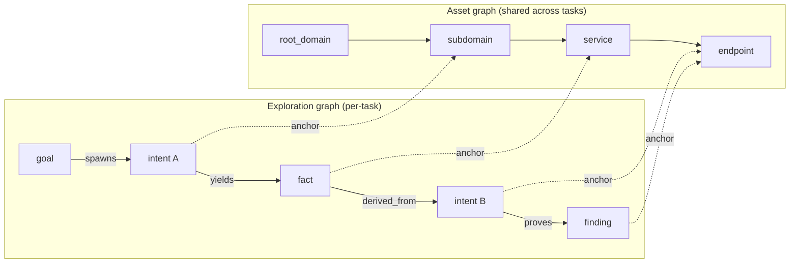
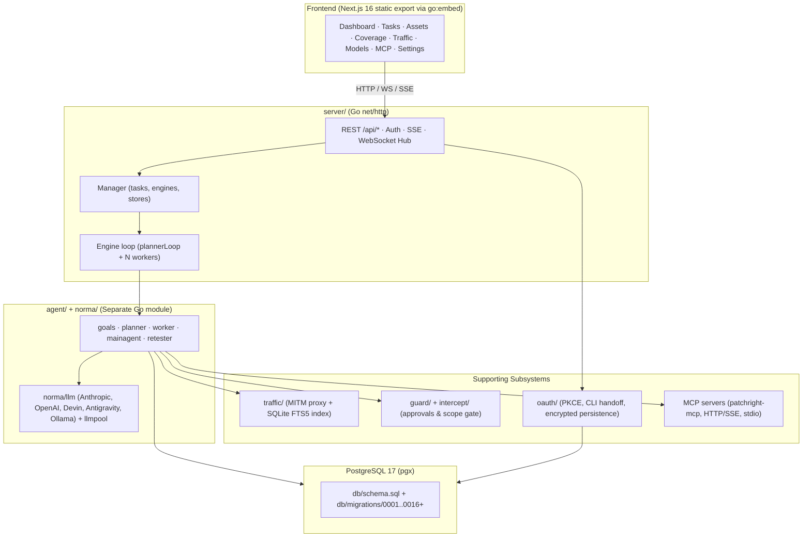

<div align="center">


# ArtexV2

**Autonomous penetration testing that keeps its receipts.**

*(Fork & evolution of [ARTEX](https://github.com/Autumn-27), licensed under AGPL-3.0)*

Self-hosted multi-agent offensive security platform. A planner explores, workers run real tools,
and every finding stays bound to the assets and HTTP traffic that prove it — running natively as a
single Go binary with an embedded Next.js UI, zero Docker required.

[](LICENSE)
[](go.mod)
[](web/package.json)

[Quick Start (Zero-Docker)](#quick-start-zero-docker--macos) · [Native macOS App](#native-macos-app) · [LLM Providers](#llm-providers--oauth) · [Patchright Browser MCP](#browser-automation-patchright-mcp) · [Architecture](#architecture) · [Development & Testing](#development--testing) · [Security](SECURITY.md)

</div>

---

## Overview

ArtexV2 is a self-hosted, LLM-driven penetration testing platform. It is not a chat wrapper around
a scanner: a planner splits a goal into intents, workers execute them with real tools, and the
results are written back into **two linked graphs**: one for what you know about the target, one
for how the test is progressing. Every finding can carry the captured request and response that
justify it, and every autonomous action passes through scope rules, approval gates, and budgets.

### What's New in ArtexV2

- **Zero-Docker Native Execution**: Runs directly on macOS/Linux with a single Go binary (`./artex`)
  embedding the pre-compressed Next.js 16 static UI (`server/webui/dist`) and native PostgreSQL 17.
- **Native macOS Desktop App (`/Applications/Artex.app`)**: Lightweight Swift + `WKWebView` wrapper
  (`desktop/macos/`) that auto-starts PostgreSQL 17 and `./artex` on `127.0.0.1:8797` (proxy on
  `127.0.0.1:8798`), with Dock integration and local loopback passwordless setup.
- **Expanded LLM Providers & Real Connection LEDs**: First-class support for **Devin** (PKCE OAuth +
  Connect/Protobuf with native prompt caching), **Antigravity CLI** (`agy acp` pooled sessions + TCP
  MCP bridge), **ChatGPT / Codex OAuth**, **Claude OAuth**, **Anthropic**, **OpenAI**, **OpenCode**,
  OpenAI-compatible gateways, and keyless local **Ollama** — with live green/red/amber connection
  status LEDs and a "Check connections" probe.
- **Patchright Browser MCP (Stealth Default)**: Built-in `browser` MCP server powered exclusively by
  [`patchright`](https://github.com/Kaliiiiiiiiii-Vinyzu/patchright) (`tools/patchright-mcp/` →
  `patchright-mcp`) with Chromium Headless Shell for anti-detection browser automation.
- **Local Cybersecurity RAG (`secrag` MCP)**: Offline 3-stage hybrid knowledge base
  (`tools/secrag-mcp/` → `secrag-mcp` + `secrag-ingest`) combining SQLite FTS5 (BM25), USearch HNSW
  (`f16` mmap), `BAAI/bge-small-en-v1.5` (Apple Silicon MPS GPU bulk indexing + FastEmbed ONNX query
  runtime), and `Xenova/ms-marco-MiniLM-L-6-v2` cross-encoder reranking (~0.7s warm latency;
  configurable via `SECRAG_RERANK_MODEL`) over HackTricks,
  PayloadsAllTheThings, OWASP, GTFOBins/LOLBAS/WADComs, MITRE ATT&CK, Atomic Red Team, SigmaHQ,
  Nuclei Templates, CISA KEV, Exploit-DB, PoC-in-GitHub, Bug Bounty writeups, and dual-tier
  CVEListV5 (2020–2026).
- **4-Locale i18n Parity**: Full localization across **English (`en`)**, **Português do Brasil
  (`pt-BR`)**, **Türkçe (`tr`)**, and **简体中文 (`zh-CN`)** with automated parity tests.
- **Hardened Security & Performance**: Strict same-origin CORS/WebSocket enforcement, anti-CSRF
  loopback guards, AES-256-GCM secrets at rest, FTS5 trigram DoS protection, streaming FIFO tool
  barriers, and an automated multi-agent audit workflow (`workflows/bug_hunt.py`).

---

## Quick Start (Zero-Docker / macOS)

### Prerequisites

- **Go 1.26+** (e.g. `~/.local/go/bin/go`)
- **Node.js 22+ & npm** (for building the embedded frontend and Patchright MCP)
- **PostgreSQL 17** (`brew install postgresql@17 && brew services start postgresql@17`)

### 1. Environment & Database

```bash
export PATH="$HOME/.local/go/bin:/opt/homebrew/opt/postgresql@17/bin:/opt/homebrew/bin:$HOME/.local/bin:$PATH"
createdb artex 2>/dev/null || true
export ARTEX_PG_DSN="postgres://${USER}@127.0.0.1:5432/artex?sslmode=disable"
```

### 2. Build Single Binary (with Embedded UI)

```bash
ARTEX_OUTPUT=./artex ./build.sh
```

> `./build.sh` builds the static Next.js 16 export (`web/out`), syncs & pre-compresses it
> (Brotli + Gzip) into `server/webui/dist`, and compiles `./artex` with `-tags embedui`.
> Add `ARTEX_SKIP_FRONTEND=1` for Go-only rebuilds, or `ARTEX_SKIP_TOOLBOX=1` to skip refetching
> embedded Go security tools.

### 3. Run Locally

```bash
ARTEX_ALLOW_LOCAL_BYPASS=1 ./artex -addr 127.0.0.1:8797 -proxy 127.0.0.1:8798
```

Open **http://127.0.0.1:8797**. On direct loopback with `ARTEX_ALLOW_LOCAL_BYPASS=1`, ArtexV2 opens
directly without requiring a password prompt. Migrations (`db/migrations/0001` through `0016+`) are
applied automatically on startup.

---

## Native macOS App

ArtexV2 ships with a native Swift/WKWebView launcher in [`desktop/macos/`](desktop/macos/):

```bash
./desktop/macos/build_app.sh
open /Applications/Artex.app
```

How `/Applications/Artex.app` works:
- It is a thin native wrapper (~117 KB) that executes `/Users/thiagomacbookpro/ArtexV2/artex`
  directly (it does **not** copy `./artex` inside `.app/Contents/`).
- On launch, it starts `postgresql@17` if needed, checks `http://127.0.0.1:8797/api/health`, and
  spawns `./artex -addr 127.0.0.1:8797 -proxy 127.0.0.1:8798` with `ARTEX_ALLOW_LOCAL_BYPASS=1` and
  the full shell `PATH` (including `~/.local/bin` for `patchright-mcp`).
- **After rebuilding `./artex`**, stop any running `./artex` process before reopening `Artex.app` so
  it spawns the new binary instead of attaching to the previous instance:
  ```bash
  pkill -TERM -f "/ArtexV2/artex" || true
  open /Applications/Artex.app
  ```

---

## LLM Providers & OAuth

Configure providers in **System → Models** (`/models`). Each provider card and filter pill displays
a real-time connection status LED:
- **Green**: Verified active connection (OAuth credential valid, API key configured, or Ollama reachable).
- **Red**: Disconnected / not configured.
- **Amber**: Verification or refresh error (hover/expand for details; click **Check connections** to re-probe).

Supported providers:

| Provider | Auth Method | Transport / Notes |
| --- | --- | --- |
| **Devin** | OAuth (PKCE loopback) | Connect + Protobuf (`server.codeium.com`), native ephemeral prompt caching, dynamic model catalog |
| **Antigravity CLI** | OAuth (`agy acp --login`) | Pooled `agy acp` sessions + TCP MCP tool bridge, SHA-512 auto-download or `ARTEX_AGY_PATH` |
| **ChatGPT / Codex** | OAuth | OpenAI Responses API |
| **Claude OAuth** | OAuth | Anthropic Messages API |
| **Anthropic** | API Key | Base URL **without** `/v1` (e.g. `https://api.anthropic.com`) |
| **OpenAI / Gateways** | API Key | Base URL **with** `/v1` (e.g. `https://api.openai.com/v1`); supports any OpenAI-compatible gateway |
| **OpenCode** | OAuth / API Key | Multi-model routing |
| **Ollama** | Keyless (local) | Default `http://127.0.0.1:11434/v1` with live reachability probe |

### Multi-Provider Worker Rotation & Failover

Tasks accept an ordered **LLM config chain** (`llm_profile_ids`) with automatic failover on HTTP
errors (`429`, `5xx`, auth failures) and optional **multi-LLM worker rotation** (`llm_rotate: true`)
to distribute concurrent worker intents across providers.

---

## Browser Automation (Patchright MCP)

ArtexV2 uses **[Patchright](https://github.com/Kaliiiiiiiiii-Vinyzu/patchright)** as its primary and
default browser automation engine via a dedicated local MCP server in
[`tools/patchright-mcp/`](tools/patchright-mcp/).

- Binary: `patchright-mcp` (symlinked to `~/.local/bin/patchright-mcp`)
- Default DB entry: `mcp_servers` row `browser` → `patchright-mcp ["--headless", "--browser", "chromium"]`
- Exposes 25 browser automation tools over stdio MCP (navigation, snapshots, clicks, typing, network
  inspection, screenshots, tabs, etc.) using Patchright's patched Chromium Headless Shell.
- **Policy**: Patchright is the standard browser method; Playwright is avoided and only considered
  as an explicit fallback. Enable/disable the `browser` MCP server in **System → MCP** (`/system/mcp`).

Setup / reinstall Patchright MCP:
```bash
cd tools/patchright-mcp
npm install
npx patchright install chromium-headless-shell
ln -sf "$(pwd)/patchright-mcp" "$HOME/.local/bin/patchright-mcp"
```

---

## How It Works

### Dual-Graph Architecture: Exploration Graph + Asset Graph

ArtexV2 separates *what exists* from *how testing is progressing* into two independent graphs linked
by `exploration_anchors(node_id, asset_id)`:

- **Asset graph (shared across tasks):** Source of truth for `root_domain / subdomain / ip / service / app / endpoint`, owned by companies and deduplicated automatically.
- **Exploration graph (per task):** `goal / intent / fact / finding / hint` nodes connected by `spawns / derived_from / yields / proves` edges.



### Core Capabilities

- **Recording MITM Proxy (`:8798` / `:8788`) & Browser Extension (`extension/`)**: Captures real
  HTTP traffic and binds verbatim request/response evidence to findings, with replay and retest
  loops (`retester` agent).
- **Interception & Approval Gate**: Human-in-the-loop approvals with `string`, `regex`, and parsed
  `argv`-prefix rules.
- **Budgets & Noise Governor**: Per-task and per-intent token/turn budgets (`ARTEX_TASK_BUDGET_*`,
  `ARTEX_INTENT_BUDGET_*`), plus `ARTEX_NOISE_PROFILE=quiet|balanced|aggressive` rate limiting.
- **Untrusted-Output Boundary**: Tool results are wrapped in nonce-tagged `UNTRUSTED_OUTPUT` markers
  by default (`ARTEX_UNTRUSTED_BOUNDARY=1`).
- **ScopeSentry Sync & Reports**: Import target scope, track asset coverage, and export encrypted
  archives and verification reports.

---

## Architecture



| Directory | Responsibility |
| --- | --- |
| `cmd/artex/` | Entrypoint, CLI flags, graceful shutdown (`ShutdownAntigravityPool`, DB, proxy) |
| `server/` | HTTP/WS/SSE API, auth/CSRF guards, engine scheduler, embedded UI (`server/webui/dist`) |
| `agent/` | Planner, worker, goal decomposition, mainagent, retester, dual-graph toolset |
| `norma/` | Separate Go module (`norma/go.mod`): agent harness, streaming engine, LLM wire clients |
| `llmpool/` | Multi-provider profile pool, rotation, and HTTP-error failover |
| `oauth/` | OAuth flows (Devin, Antigravity, ChatGPT, Claude, OpenCode) + verification cache |
| `db/` | PostgreSQL (`pgx`) store, `schema.sql`, numbered migrations, AES-256-GCM secret encryption |
| `traffic/` | MITM recording proxy + SQLite FTS5 full-text search index |
| `guard/` & `intercept/` | Target scope gate, SSRF/non-public IP checks, command approval rules |
| `web/` | Next.js 16 + React 19 + Tailwind CSS 4 static frontend + 4-locale i18n |
| `tools/patchright-mcp/` | Local Patchright MCP server (`patchright-mcp`) |
| `desktop/macos/` | Native macOS Swift `WKWebView` launcher (`/Applications/Artex.app`) |
| `workflows/` | Automated multi-agent audit & bug-hunt workflow (`workflows/bug_hunt.py`) |

---

## Development & Testing

### Dev Mode (Hot Reload)

```bash
./dev.sh   # backend + traffic proxy + Next.js dev server (:5173)
```

### Verification Suite

Always export the local toolchain `PATH` before running tests:

```bash
export PATH="$HOME/.local/go/bin:/opt/homebrew/opt/postgresql@17/bin:/opt/homebrew/bin:$HOME/.local/bin:$PATH"

# 1. Go root module (with race detector)
go test -race ./...

# 2. norma/ Go module (separate go.mod)
(cd norma && go test -race ./...)

# 3. Frontend TypeScript & 4-locale i18n parity
(cd web && npm run sync:locales && npm run test:i18n && npx tsc --noEmit)

# 4. Full binary build
ARTEX_OUTPUT=./artex ./build.sh
```

---

## Security

See [SECURITY.md](SECURITY.md) for vulnerability reporting and security policies.

- **Secrets at rest**: Encrypted with AES-256-GCM using `secret.key` (or `ARTEX_SECRET_KEY`).
- **Same-origin & anti-CSRF**: Strict origin allowlisting (`ARTEX_ALLOWED_ORIGINS`), `Sec-Fetch-Site`
  and reverse-proxy header checks on loopback bypass, and login rate limiting (`ARTEX_TRUSTED_PROXIES`).
- **Backups**: Use `scripts/backup.sh` and always back up `secret.key` / `jwt.key` alongside your
  PostgreSQL dump.

---

## License & Disclaimer

Licensed under the **GNU Affero General Public License v3.0 (AGPL-3.0)** — see [LICENSE](LICENSE).

**ArtexV2 is an offensive-security tool. Use it only against systems you own or are explicitly
authorized to test within a published scope and rules of engagement. All legal responsibility lies
with the operator.**
